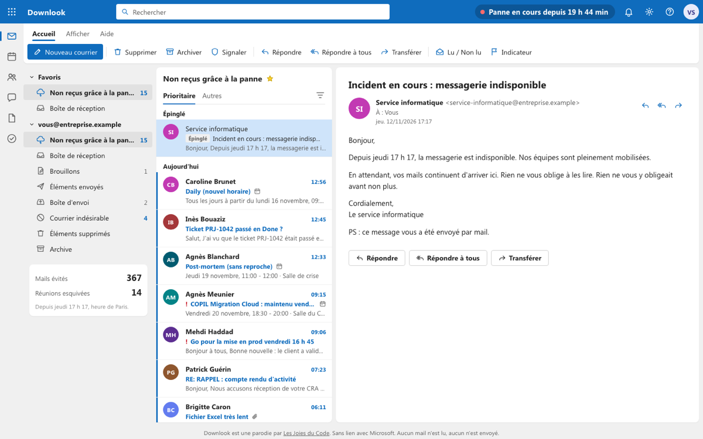

# Downlook

Parodie de webmail par Les Joies du Code : tous les mails que la panne de messagerie du
12 novembre 2026 vous a épargnés. Page 100 % statique (GitHub Pages), rien ne quitte le
navigateur : aucun formulaire, aucun champ de saisie, aucun serveur.

En ligne : https://lesjoiesducode.github.io/downlook/

## Fichiers

- `index.html`, `css/style.css`, `js/app.js` : l'interface et le moteur (tirage aléatoire, arrivées en direct, invitations, capture en PNG).
- `content/*.json` : la banque de mails (lots A, B, C). `js/mails-special.js` : accueil, dossiers, rares maison. `js/mails-extra.js` : mails qui partagent une offre d'emploi, le site d'offres ou un meme.
- `status.json` : état de la panne (`ongoing` / `ended` + heure de fin). Lu par la page au chargement puis toutes les 3 min.
- `jobs.json` : offres d'emploi actives de lesjoiesducode.fr (sitemap public des offres + JSON-LD de chaque page, offres expirées exclues). Ignoré par la page s'il a plus de 48 h.
- `memes.json` : memes récents du site (API REST publique, catégorie Memes) ; `memes-secours.json` : liste figée de secours.
- `.github/workflows/robot.yml` : toutes les 10 min, détection prudente de la fin de panne ; toutes les 30 min, offres et memes.

## Fin de panne

Automatique : `bin/check_status.py` lit `status.cloud.microsoft/api/posts/mac` (Microsoft 365 entreprise)
et `/api/posts/m365Consumer`. Il ne déclare la fin que si les deux sources affichent un statut sain
pendant 25 min d'affilée ; erreur réseau ou format inattendu = aucun changement. Il ne défait jamais
une fin posée à la main.

Manuelle (si la détection tarde ou se trompe) :

    bin/panne-terminee.sh              # fin = maintenant
    bin/panne-terminee.sh 18:40        # fin = aujourd'hui 18 h 40, heure de Paris
    bin/panne-terminee.sh "2026-11-14 09:05"
    bin/panne-terminee.sh --annuler    # remet la panne en cours

Le script met à jour `status.json`, commit et pousse ; GitHub Pages suit en 1 à 2 min.

## Debug (non documenté dans la page)

`?rare=1` (un mail rare tout de suite, ou `?rare=<id>`), `?fast` (arrivées toutes les 2 s),
`?status=<fichier>.json` (tester la fin de panne avec un autre fichier d'état), `?debug`.

## Image de partage

`og-image.jpg` (1200x675), référencée en URL absolue dans les balises Open Graph et Twitter de `index.html`.
